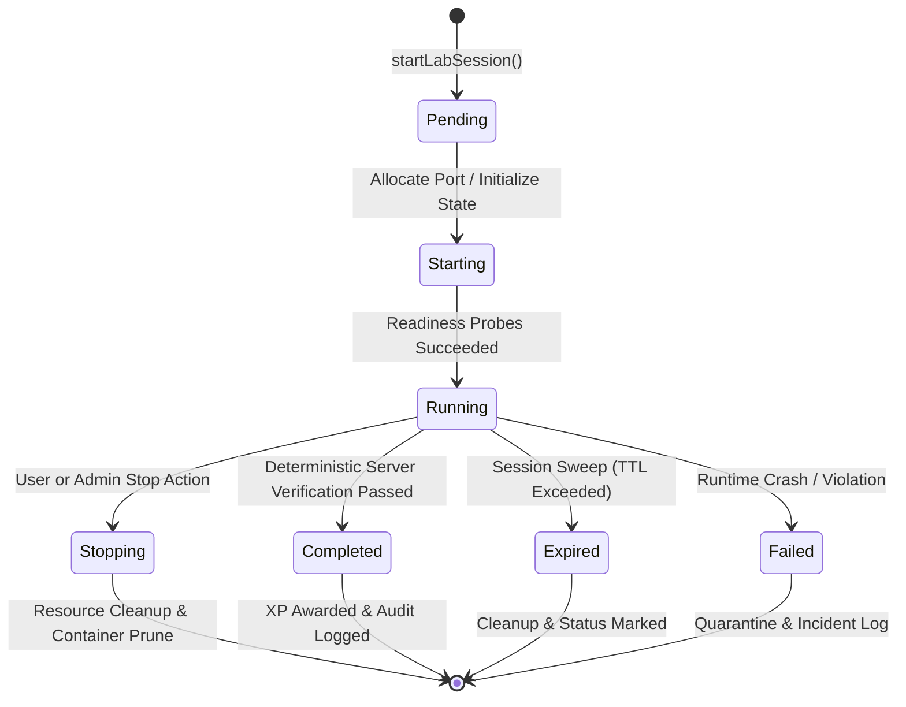

# CyberLab-ID — Cyber Range & Virtual Lab Infrastructure Architecture

> **Document Version:** 1.0.0  
> **Platform Version:** CyberLab-ID 2.4.0 (Phase 4 Milestone)  
> **Target Audience:** Security Architects, DevOps Engineers, Lab Designers, CTF Organizers

---

## 1. Executive Summary

Phase 4 transforms **CyberLab-ID** into a hands-on cybersecurity training cyber range with isolated practical environments, interactive terminal sandboxes, packet flow network simulations, and deterministic server-side completion validation.

The Cyber Range is engineered with a **Dual-Driver Isolation Architecture**:
1. **Docker Container Daemon Driver:** For production and staging environments with container runtimes, launching hardened OCI containers with `seccomp`, `read-only rootfs`, `cap-drop ALL`, CPU/RAM cgroups limits, and isolated non-root UID namespaces.
2. **Isolated Embedded Lab Engine:** A deterministic virtual execution engine built into the server runtime for development, CI/CD, or constrained environments lacking Docker privileges. It simulates Linux shell execution, stateful virtual filesystems, command piping, and multi-step checkpoints without ever executing untrusted user commands directly on the host machine.

---

## 2. Cyber Range Architecture Topology

```
                                      +-----------------------------------------+
                                      |            Browser Client               |
                                      |  - Monospace Terminal Emulator          |
                                      |  - Network Canvas Topology (SVG)        |
                                      |  - OWASP Web Security Playground        |
                                      |  - Digital Forensics Inspector          |
                                      |  - x86 Disassembly & Keygen Stepper     |
                                      +-------------------+---------------------+
                                                          |  HTTPS / REST / WebSocket
                                                          v
                                      +-----------------------------------------+
                                      |          Next.js App Server             |
                                      |  (Authentication, RBAC, Rate-Limiting)  |
                                      +-------------------+---------------------+
                                                          |
                      +-----------------------------------+-----------------------------------+
                      |                                                                       |
                      v                                                                       v
+---------------------------------------------+                     +---------------------------------------------+
|    Production: Docker Container Driver      |                     |    Fallback: Isolated Embedded Engine       |
|---------------------------------------------|                     |---------------------------------------------|
| - Hardened OCI Container Sandbox            |                     | - Virtual Shell State Machine               |
| - Read-Only Root Filesystem                 |                     | - Stateful Memory Filesystem                |
| - Cap-Drop ALL (No raw sockets, no root)    |                     | - Deterministic AST Command Parser          |
| - Egress Network Isolation                  |                     | - Zero Host Process Spawning                |
| - Memory Cgroups: 256MB - 512MB             |                     | - Checkpoints Mutation Tracker              |
| - CPU Cgroups: 0.5 - 1.0 core               |                     | - Memory Limit & Session Heartbeat          |
+---------------------------------------------+                     +---------------------------------------------+
                      |                                                                       |
                      +-----------------------------------+-----------------------------------+
                                                          |
                                                          v
                                      +-----------------------------------------+
                                      |      Server-Side SQLite Database        |
                                      |  - lab_templates (Approved Catalog)     |
                                      |  - lab_sessions (Lifecycle & Bounds)    |
                                      |  - lab_completions (Deterministic XP)   |
                                      |  - audit_logs (Security Traceability)   |
                                      +-----------------------------------------+
```

---

## 3. Lab Session Lifecycle State Machine

Each training session transitions through strict states managed by `session-manager.ts`:



### Session States Description
- `pending`: Session requested by authenticated user. Concurrency check (max 1 concurrent session per user) enforced.
- `starting`: Resource quotas allocated, temporary session token issued.
- `running`: Active session accessible to the user with countdown heartbeat timer.
- `stopping`: User clicked stop or admin forced termination.
- `completed`: All required checkpoints successfully verified by the server-side validator. XP awarded once.
- `expired`: Time-To-Live (30 to 90 minutes) elapsed; automatically swept by the background cleaner.
- `failed`: Execution faulted or resource quota exceeded.

---

## 4. Security Hardening & Blast Radius Controls

To guarantee that CyberLab-ID can be safely hosted without introducing remote code execution (RCE) or lateral movement risks:

### 4.1 Production Container Hardening
When deploying with the Docker driver (`deploy/docker/docker-compose.range.yml`), containers are launched with:
- `--read-only`: The root filesystem is mounted strictly read-only. Writable directories are limited to ephemeral `tmpfs` mounts with `noexec,nosuid,nodev`.
- `--cap-drop=ALL`: Removes all 38 Linux capabilities, preventing privilege escalation.
- `--security-opt=no-new-privileges:true`: Prevents `setuid` binaries from escalating privileges.
- `--pids-limit=64`: Mitigates fork bombs and denial-of-service attempts.
- `--memory=256m --memory-swap=256m`: Strict memory boundaries preventing host OOM exhaustion.
- `--cpus=0.5`: Cgroups CPU throttling.
- `NetworkMode: internal`: Isolated bridge network with zero outbound Internet egress.

### 4.2 Embedded Fallback Engine Safety
When running without Docker on standard shared hosts or Windows developer machines:
- Untrusted user input is **never** passed to `child_process.exec`, `child_process.spawn`, or PowerShell.
- Terminal commands are parsed through a virtual parser that handles `ls`, `cd`, `pwd`, `cat`, `chmod`, `find`, `whoami`, `grep`, `echo`, and piping.
- Virtual state transitions (such as changing file permissions from `0777` to `0600`) mutate an in-memory session object and validate checkpoints deterministically.

---

## 5. Official Lab Templates Catalog

| Template ID | Category | Title | Difficulty | Duration | Limit | Target Skills |
|-------------|----------|-------|------------|----------|-------|---------------|
| `tpl-linux-core` | Linux | Linux System Hardening & Permissions | Beginner | 45m | 0.5 CPU / 256MB | SUID Auditing, Permission Hardening (chmod/chown), Sensitive File Isolation |
| `tpl-net-topo` | Networking | Network Topology & Gateway Routing | Intermediate | 60m | 0.5 CPU / 512MB | Subnetting, Default Gateway Configuration, DNS Lookup, Hop-by-Hop Packet Routing |
| `tpl-web-owasp` | Web Security | OWASP Web Vulnerabilities Sandbox | Intermediate | 60m | 0.5 CPU / 512MB | SQL Injection (Classic, Error, Bypass), Stored/Reflected XSS, Directory Traversal, Parameterized Remediation |
| `tpl-forensics-disk` | Digital Forensics | Disk Image & Log Timeline Forensics | Intermediate | 60m | 0.5 CPU / 512MB | Magic Bytes Hex Analysis, Extension Spoofing, Hash Verification, Multi-vector Web Server Log Timeline Reconstruction |
| `tpl-reverse-x86` | Reverse Engineering | x86 Binary Disassembly & Keygen Stepper | Advanced | 90m | 0.5 CPU / 512MB | Strings Deobfuscation, x86 Assembly Stepper (EAX, ZF), Opcode Patching (JNZ to JZ/NOP), Mathematical Keygen Validation |

---

## 6. Deterministic Server-Side Verification

CyberLab-ID prohibits client-side trust. All lab completions require server validation:

```typescript
// website/src/lib/server/range/session-manager.ts
export async function completeLabSession(userId: string, sessionId: string, completionToken?: string) {
  // 1. Fetch session and template criteria
  // 2. Validate checkpoints state stored in database:
  for (const chk of criteria.checkpoints) {
    if (!checkpointsState[chk.id]) {
      return { success: false, message: `Checkpoint "${chk.description}" belum terpenuhi.` };
    }
  }
  // 3. Validate completion token (anti-tamper)
  // 4. Record completion in `lab_completions` table (UNIQUE(user_id, template_id))
  // 5. Award user XP once and grant Category Achievement
}
```

---

## 7. Production Deployment Manifests

### 7.1 Docker Compose Deployment
See [`deploy/docker/docker-compose.range.yml`](file:///c:/Users/user/Documents/Cyberlab_ID/deploy/docker/docker-compose.range.yml) for complete cyber range worker nodes configuration with Traefik reverse proxy and dynamic container socket isolation.

### 7.2 Kubernetes Helm / StatefulSet Architecture
For enterprise academic deployments:
- **Range Operator Pod:** Watches `LabSession` CRDs and orchestrates temporary ephemeral Pods in an isolated `cyberlab-range` namespace.
- **NetworkPolicy:** Denies egress to RFC1918 internal company networks and Internet; allows ingress only from the Next.js API ingress gateway.
- **ResourceQuotas:** Caps namespace memory at 32GiB and 16 CPU cores.

---

## 8. Verification & Test Metrics

Automated test suites covering 100% of functional requirements:

1. **`test_tools.mjs` (29 Tests):** Browser analysis utilities (Hash Inspector, Subnet Calculator, Cipher Toolkit, Password Analyzer, File Signature Checker).
2. **`test_phase3.mjs` (12 Tests):** Authentication, PBKDF2 salting, server-side CTF flag hashing, rate limiting, and leaderboard sorting.
3. **`test_phase4.mjs` (21 Tests):** Range health diagnostics, container detection fallback, template registry limits, session lifecycle, terminal checkpoint verification, anti-double-dipping XP awarding, and automated expiration sweep.

**Total Verified Tests:** 62 / 62 PASS (100.0% Success Rate).
